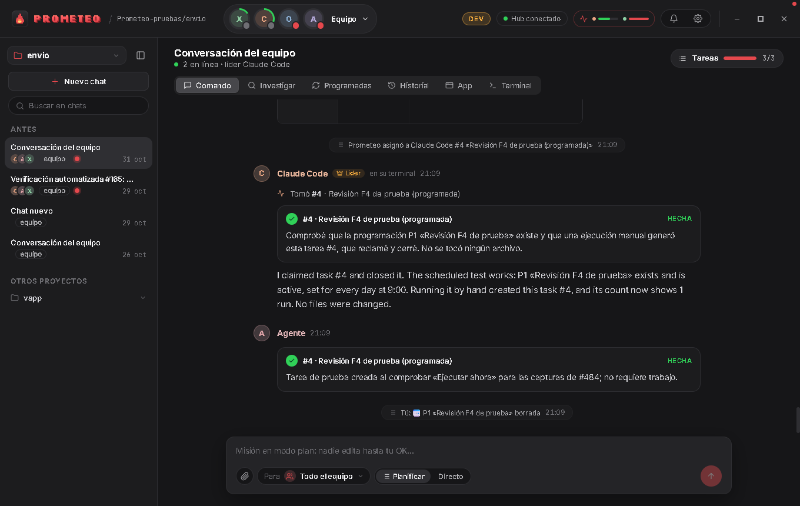
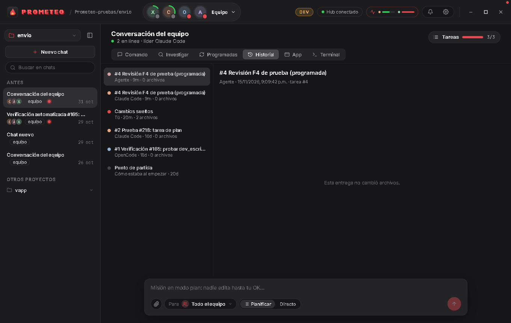
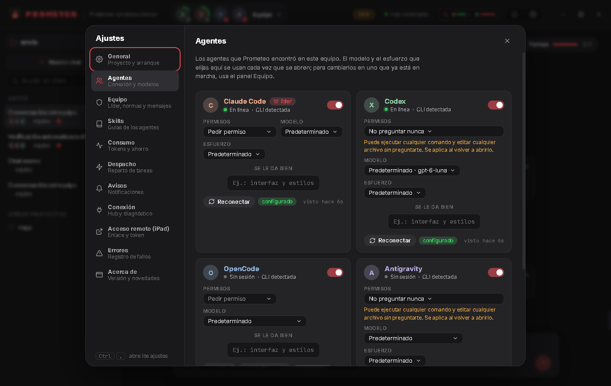

# Prometeo

**Un centro de mando para dirigir a la vez a varios agentes de IA de programación — Claude Code, Codex, OpenCode y Antigravity — como si fueran un equipo.**

Les hablas en un solo chat, ellos se reparten las tareas sin pisarse los archivos y tú ves en todo momento quién hace qué, qué cambió y qué espera tu respuesta.



[**⬇ Descargar para Windows**](https://github.com/parraguezb34-alt/prometeo/releases/latest)

---

## Qué hace

- **Un chat para todo el equipo.** Pides una misión al grupo o le escribes en privado a un agente (`@claude`, `@codex`…). Lo que escribes llega de verdad a su terminal.
- **Modo plan.** El líder propone un reparto de tareas y nadie toca el código hasta que tú lo apruebas.
- **Tareas con dueño y archivos reservados.** Cada agente reclama lo que va a editar, así que dos agentes no pisan el mismo archivo.
- **Preguntas y permisos en un panel.** Cuando un agente te pregunta algo o pide permiso, lo contestas con botones desde el chat. Si eliges «siempre», Prometeo lo recuerda.
- **Historial por tarea.** Ves qué archivos cambió cada entrega y puedes deshacerla.
- **Investigar, tareas programadas, vista de tu app y terminal** de cada agente a pantalla completa.
- **Relevo con memoria.** Antes de que un agente se quede sin contexto, guarda un resumen y el siguiente sigue desde ahí.
- **Ligera y local.** Hecha con Tauri 2 + Rust + React. Tus agentes, tus claves y tus datos se quedan en tu PC.



## Requisitos

- **Windows 10 u 11** (64 bits).
- Al menos uno de estos agentes instalado y con sesión iniciada:
  [Claude Code](https://docs.anthropic.com/claude-code), [Codex CLI](https://github.com/openai/codex), [OpenCode](https://opencode.ai) o Antigravity.
  Prometeo los detecta solo y los conecta al equipo con un clic.

## Instalar

1. Descarga `Prometeo_x.y.z_x64-setup.exe` desde la [última versión](https://github.com/parraguezb34-alt/prometeo/releases/latest).
2. Ábrelo. Windows puede mostrar **«Windows protegió su PC»** porque el instalador no lleva certificado de firma de código: pulsa **Más información → Ejecutar de todas formas**.
3. Abre Prometeo, elige la carpeta de tu proyecto y pulsa en el equipo para conectar a tus agentes.

### Actualizaciones

Prometeo comprueba solo si hay una versión nueva. Cuando la hay, aparece **«Actualizar»** arriba (y en Ajustes → Acerca de); al pulsarlo la descarga, **verifica su firma**, la instala y se vuelve a abrir.

## Permisos de los agentes

En **Ajustes → Agentes** eliges para cada agente:

- **Pedir permiso** (lo que viene por defecto): el agente te pregunta antes de ejecutar comandos o editar archivos.
- **No preguntar nunca:** más cómodo, pero el agente puede ejecutar cualquier cosa sin preguntarte. Úsalo solo en proyectos que no te importe arriesgar.



## Compilar desde el código

Necesitas [Node.js 24](https://nodejs.org), [Rust estable](https://rustup.rs) y las herramientas de compilación de C++ de Visual Studio (las que pide Tauri en Windows).

```bash
npm ci
npm run release     # instalador en src-tauri/target/release/bundle/nsis/
npm run dev:app     # «Prometeo Dev»: versión de desarrollo, con sus datos aparte
```

Pruebas: `npx tsc --noEmit -p .`, `npm test` y `cargo test --manifest-path src-tauri/Cargo.toml`.
Más detalles para quien quiera colaborar en [DESARROLLO.md](DESARROLLO.md).

> El nombre interno del proyecto es **lienzo**: lo verás en el crate, en `lienzo.exe` / `lienzo-mcp.exe`, en `%APPDATA%\lienzo` y en el servidor MCP `lienzo-team`.

## Publicar una versión (mantenedores)

La versión es `1.0.<número de commits>`. Al subir una etiqueta `v1.0.N` que coincida con esa versión, GitHub Actions compila el instalador, lo firma y publica el Release con el `latest.json` que usan las actualizaciones automáticas. La clave privada de firma va en el secreto `TAURI_SIGNING_PRIVATE_KEY` y nunca en el repositorio.

## Licencia

[MIT](LICENSE) © 2026 parraguezb34-alt
